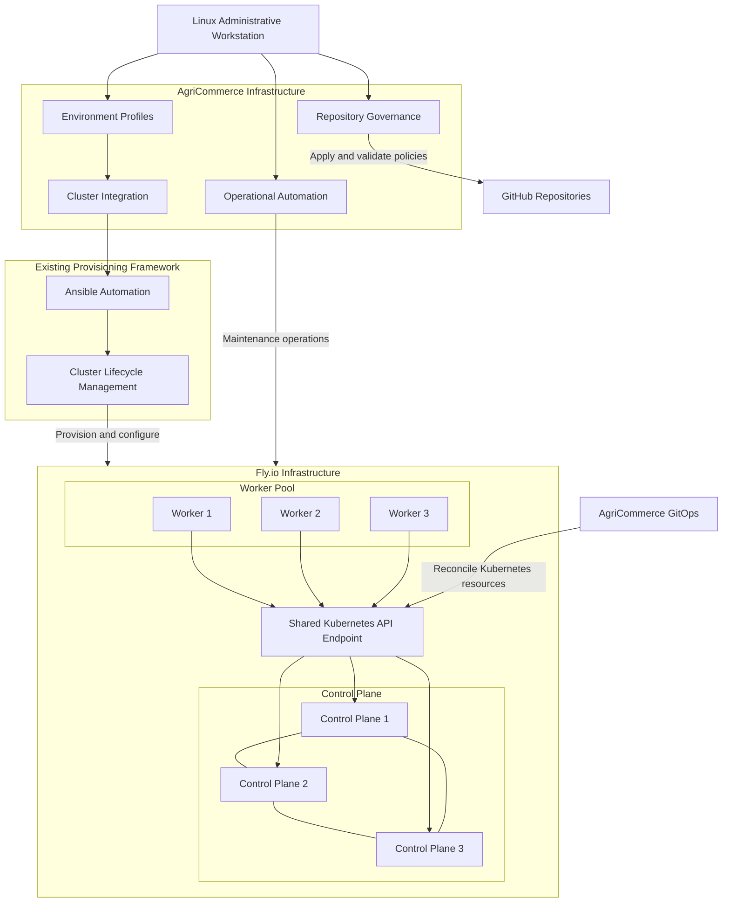
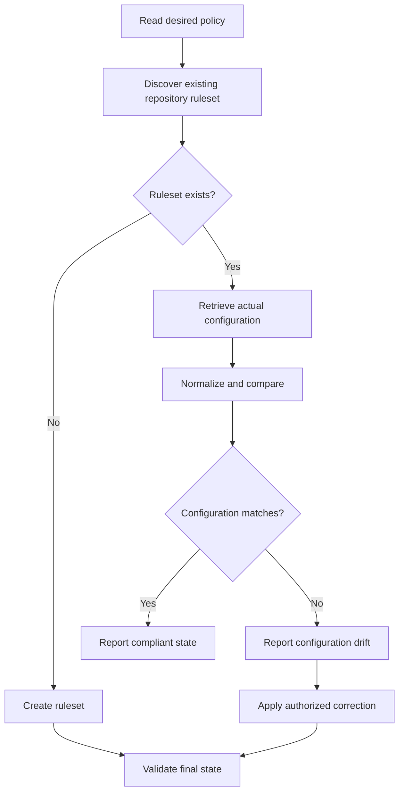

# AgriCommerce | Infrastructure Engineering

Infrastructure provisioning, configuration management,
repository governance and operational automation for the
AgriCommerce Kubernetes Progressive Delivery Platform.


## Overview

This repository manages the infrastructure configuration,
integration and operational automation required by the
AgriCommerce platform.

The infrastructure is designed to support reproducible
Kubernetes environments, controlled failure exercises,
high-availability testing, secure software delivery and
disaster recovery.

The project uses self-managed Kubernetes on Fly.io Machines.

An existing Ansible-based Kubernetes provisioning framework
provides the initial foundation for cluster lifecycle
management.

## Related Repositories

| Repository | Responsibility |
|---|---|
| [agricommerce-platform](https://github.com/Oluadepe/agricommerce-platform) | Platform architecture, ADRs and engineering evidence |
| [agricommerce-app](https://github.com/Oluadepe/agricommerce-app) | Application source code and continuous integration |
| agricommerce-infrastructure | Infrastructure integration and operational automation |
| agricommerce-gitops | Planned application and platform-service delivery |

## Project Status

Active development.

The existing Kubernetes provisioning framework has previously
demonstrated multi-node cluster provisioning and basic
workload connectivity.

AgriCommerce-specific infrastructure integration and
operational capabilities remain subject to implementation
and validation.

## Engineering Objectives

- Provision reproducible Kubernetes infrastructure.
- Support configurable control-plane and worker topology.
- Reuse existing infrastructure automation.
- Maintain explicit infrastructure lifecycle management.
- Implement consistent repository governance.
- Detect and reconcile governance configuration drift.
- Establish secure credential management.
- Support highly available cluster configurations.
- Automate safe Kubernetes maintenance procedures.
- Validate persistent storage and recovery strategies.
- Minimize infrastructure expenditure.

## Infrastructure Architecture



The illustrated topology represents the proposed
high-availability test environment.

Smaller cluster configurations may be used for development
and isolated integration exercises.

## Infrastructure Provisioning Strategy

The project separates generic Kubernetes provisioning
from AgriCommerce-specific infrastructure requirements.

The existing provisioning framework will remain an
independent dependency.

This repository will provide integration logic,
environment configuration, validation and operational
automation without unnecessarily duplicating the
existing provisioning implementation.

Dependency versions and compatibility requirements
will be documented during integration.

## Environment Strategy

| Environment | Purpose | Proposed Topology |
|---|---|---|
| Development | Application integration and basic Kubernetes exercises | Minimal control plane and worker pool |
| Integration | Networking, storage and deployment validation | Configurable multi-node cluster |
| Production simulation | HA, scalability and failure testing | Three control planes and three workers |
| Disaster recovery | Infrastructure reconstruction and restoration | Disposable recovery cluster |

These are logical exercise profiles.

The project does not require all environments to run
simultaneously.

## Technology Stack

| Technology | Responsibility |
|---|---|
| Fly.io Machines | Compute infrastructure |
| Fly Volumes | Machine-attached persistent storage |
| Ansible | Infrastructure and operational automation |
| Bash | Administrative automation |
| Python | Validation and automation utilities |
| kubeadm | Kubernetes bootstrap and upgrades |
| Kubernetes | Workload orchestration |
| containerd | Container runtime |
| Calico | Kubernetes networking and policy |
| CoreDNS | Service discovery |
| etcd | Kubernetes cluster state |
| GitHub REST API | Repository governance |
| GitHub CLI | Authenticated repository operations |
| JSON and YAML | Machine-readable configuration |

## Repository Governance

Repository governance will be managed using reusable
GitHub ruleset configurations.

The initial baseline requires:

- Protected default branches.
- Pull requests for changes to protected branches.
- Branch deletion restrictions.
- Non-fast-forward update restrictions.
- Resolution of review conversations.
- No configured ruleset bypass actors.

The policy has been replicated from the platform repository
to the application repository.

Configuration comparison returned exit code zero.

Direct pushes to the protected default branch were rejected
with GitHub error GH013 in both repositories.

Reusable idempotent governance automation and intentional
drift testing remain pending.

## Governance Automation Design



Automation must distinguish resource discovery,
configuration comparison and authorized modification.

Repeated execution against an already compliant
repository should produce no unnecessary changes.

## Planned Repository Structure

```text
agricommerce-infrastructure/
├── governance/
│   └── github/
│       ├── policies/
│       └── scripts/
├── ansible/
│   ├── inventories/
│   ├── playbooks/
│   └── roles/
├── profiles/
├── scripts/
├── tests/
├── docs/
│   ├── architecture/
│   └── runbooks/
├── .github/
│   └── workflows/
├── .gitignore
└── README.md
```

## Kubernetes Lifecycle Management

The infrastructure integration will support:

- Cluster provisioning.
- Cluster health validation.
- Node readiness verification.
- Workload connectivity testing.
- Controlled node maintenance.
- Supported Kubernetes version upgrades.
- Cluster recovery.
- Infrastructure teardown.
- Resource ownership validation.

Destructive operations must be explicitly scoped
to project-owned resources.

## High Availability

Advanced operational exercises will use a three-member
control-plane and etcd topology.

Application availability will also depend on:

- Redundant application workloads.
- Sufficient worker capacity.
- Reliable API endpoint routing.
- Redundant external traffic routing.
- PodDisruptionBudgets.
- Appropriate workload placement.
- Persistent data availability.
- Tested recovery procedures.

A highly available control plane alone does not guarantee
application availability.

## Networking Strategy

The existing provisioning framework uses IPv6 Kubernetes
networking with Calico.

AgriCommerce integration must validate compatibility across:

- Pod-to-pod connectivity.
- Kubernetes Service routing.
- CoreDNS resolution.
- Network policy enforcement.
- External application traffic.
- Gateway controller functionality.
- Observability components.
- Persistent data services.

External routing and the final Gateway implementation
will be selected during integration.

## Storage and Recovery

Fly Volumes provide machine-attached persistent block
storage.

The design must account for storage locality, node
failure and recovery constraints.

Persistent volume availability and database availability
must be evaluated independently.

The project will implement and validate:

- Persistent volume provisioning.
- Kubernetes storage integration.
- PostgreSQL backup and restoration.
- Database replication and failover.
- etcd snapshot management.
- Kubernetes resource backup.
- Cluster reconstruction.

Storage driver selection and recovery targets will
be finalized during implementation.

## Operational Engineering Scenarios

| Scenario | Objective |
|---|---|
| GOV-003 | Replicate and validate repository governance |
| GOV-004 | Detect and reconcile configuration drift |
| GOV-005 | Validate idempotent governance automation |
| OPS-001 | Upgrade Kubernetes with zero observed application downtime |
| OPS-002 | Validate control-plane failure handling and etcd quorum |
| OPS-003 | Validate worker failure and workload recovery |
| OPS-004 | Diagnose Kubernetes DNS failures |
| OPS-005 | Diagnose scheduling and resource constraints |
| OPS-006 | Validate persistent storage failure recovery |
| DR-002 | Reconstruct a lost Kubernetes cluster |

The mandatory Kubernetes upgrade scenario is documented
in the central platform repository:

[OPS-001: Zero-Downtime Kubernetes Cluster Upgrade](https://github.com/Oluadepe/agricommerce-platform/blob/main/docs/scenarios/OPS-001-kubernetes-cluster-upgrade.md)

## Security Requirements

- Never commit credentials or access tokens.
- Prefer short-lived scoped infrastructure credentials.
- Restrict administrative access.
- Validate infrastructure resource ownership.
- Avoid unnecessary public management endpoints.
- Protect repository default branches.
- Apply least-privilege permissions.
- Protect backups and recovery artifacts.
- Separate governance validation from authorized changes.

## Cost Management

The project uses disposable infrastructure to minimize
unnecessary cloud expenditure.

Infrastructure will be provisioned only when required
for implementation or operational validation.

Machine and volume sizes will be selected according
to the requirements of each exercise.

Teardown procedures must verify that project-owned
temporary infrastructure has been removed.

Persistent administrative workstation resources are
managed separately.

## Implementation Roadmap

- [ ] Establish infrastructure repository.
- [ ] Apply and validate repository governance.
- [ ] Version-control the reusable governance policy.
- [ ] Implement governance validation automation.
- [ ] Implement idempotent governance reconciliation.
- [ ] Validate intentional configuration drift.
- [ ] Document existing provisioning dependencies.
- [ ] Define environment profiles.
- [ ] Implement cluster provisioning integration.
- [ ] Validate Kubernetes networking.
- [ ] Integrate persistent storage.
- [ ] Implement external traffic routing.
- [ ] Validate infrastructure high availability.
- [ ] Implement safe cluster upgrade automation.
- [ ] Validate backup and recovery.
- [ ] Publish operational engineering evidence.

## Known Limitations

- AgriCommerce-specific cluster integration is not yet
  validated.
- Fly.io regional capacity may affect provisioning.
- Persistent block storage requires explicit recovery design.
- IPv6 compatibility requires component-level testing.
- Automated governance reconciliation is not yet implemented.
- Independent human pull request approval is not required
  in the initial single-contributor governance baseline.

## References

- [Fly.io Machines](https://fly.io/docs/machines/)
- [Kubernetes Documentation](https://kubernetes.io/docs/)
- [Ansible Documentation](https://docs.ansible.com/)
- [GitHub REST API](https://docs.github.com/en/rest)
- [ADR-001: Infrastructure Selection](https://github.com/Oluadepe/agricommerce-platform/blob/main/docs/adr/ADR-001-infrastructure-selection.md)

## Author

Olusegun Mayungbe

Part of the AgriCommerce Kubernetes Progressive Delivery
Platform engineering portfolio.
